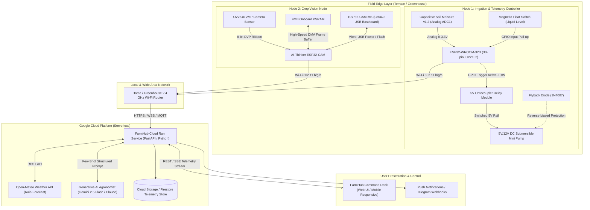
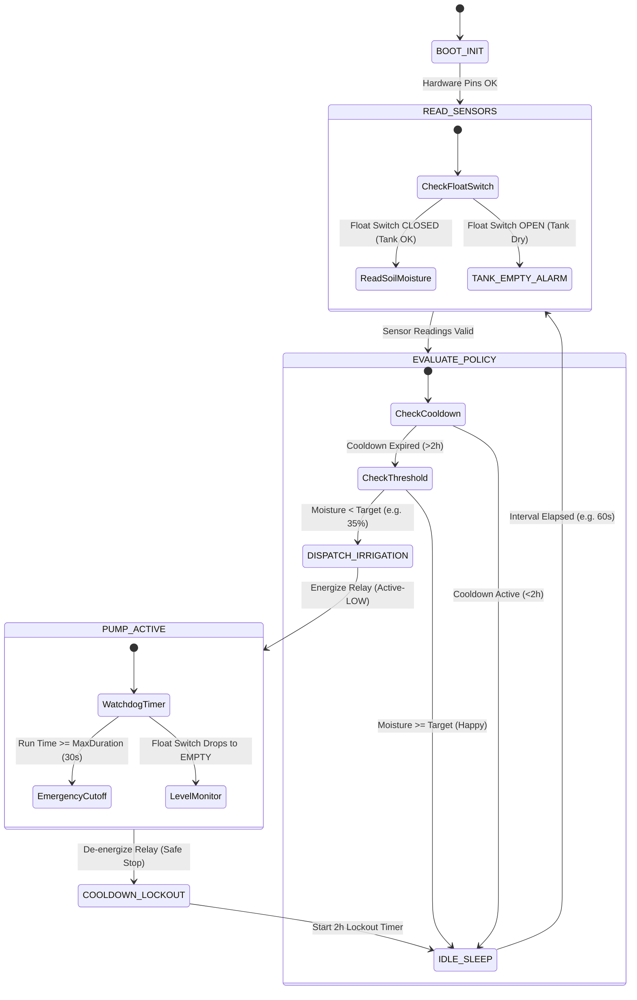

# FarmHub AI: Edge IoT Precision Irrigation & Crop Monitoring System
## Solution Architecture & Technical Design Document (RFC & Architecture Review)

> **Document Status**: Ready for Review / RFC  
> **Target Audience**: Cloud Architects, Embedded IoT Engineers, Senior System Reviewers (e.g., Anthropic Claude / Google Cloud)  
> **System Purpose**: Automated, weather-aware, closed-loop precision irrigation and visual plant health monitoring with dual-layer edge/cloud intelligence.

---

## 📋 Copy-Paste Prompt for Claude Review

If you are pasting this document into Claude for an architectural critique, you can copy the box below along with this entire document:

```text
Hi Claude, 
Please act as a Principal IoT Embedded Architect and Cloud Solutions Specialist. 
Below is our complete Solution Architecture & Technical Design Document for "FarmHub AI" — an autonomous precision irrigation and crop monitoring IoT solution using a split-node edge design (ESP32 for irrigation + ESP32-CAM for vision) and a serverless Google Cloud Run backend with AI agronomist advisory.

Please review our architecture and address the following questions:
1. Is our split-node edge architecture (ESP32 telemetry/relay + separate ESP32-CAM vision) the best engineering choice, or should we consider an all-in-one or alternative topology?
2. Are our edge-side safety guardrails (hardware interlocks, local cooldowns, pump timeout watchdogs) robust enough to prevent flooding or pump burnout under network failure?
3. How can we optimize our telemetry & communication protocol (HTTP REST vs. MQTT vs. WebSockets) considering reliability, power efficiency, and cold-start latency on Cloud Run?
4. What are the best practices for the computer vision pipeline on the ESP32-CAM (edge capture vs. cloud inference for leaf yellowing, pest detection, and soil dryness)?
5. What blind spots, failure modes, or scalability bottlenecks do you see in this design, and what specific improvements would you recommend?
```

---

## 1. Executive Summary & Problem Statement

### 1.1 The Challenge
Urban home growers, terrace gardeners, and smallholder polyhouse operators face three primary dilemmas:
1. **Irrigation Inefficiency**: Over-watering causes root rot, fungal diseases, and water waste; under-watering causes plant stress, stunted growth, and crop failure.
2. **Hardware Vulnerability**: Submersible DC mini pumps frequently burn out when reservoirs run dry. Cheap resistive soil sensors corrode within weeks due to galvanic DC electrolysis.
3. **Cloud Latency & Network Fragility**: Many commercial IoT systems rely on pure cloud control ("cloud-actuated relays"). When Wi-Fi disconnects or cloud services experience downtime, pumps either fail to turn on or—worse—stay stuck ON, flooding plants.

### 1.2 The FarmHub Solution
FarmHub AI implements a **fail-safe, dual-layer hybrid architecture** phased into an immediate **Phase 1 MVP** and a future **Phase 2 Vision Pipeline**:
* **Layer 1 (Edge Autonomous Safety - Phase 1 MVP)**: A dedicated 30-pin ESP32 node continuously executes deterministic hardware safety interlocks (float-switch pump cutoff, NVS-persisted 2-hour cooldown timer immune to village power cuts, closed-loop soil delta verification, and a 30-second hard watchdog shutdown) locally on bare silicon. If the internet or cloud dies, plants are never over-watered or flooded.
* **Layer 2 (Cloud ReAct Agentic Intelligence - Phase 1 MVP)**: A containerized FastAPI backend on Google Cloud Run executes a genuine **ReAct Tool-Calling Agent** (`get_sensor_telemetry`, `get_weather_forecast`, `get_watering_history`, `propose_irrigation`). All AI proposals are strictly authorized by a deterministic cloud guardrail before actuation commands are dispatched.
* **Layer 3 (Command Deck UI - Phase 1 MVP)**: A sleek, responsive dark-mode dashboard with interactive crop profile configuration (`crops_config.json`), dynamic volumetric moisture dials, reservoir alerts, delivery verification tracking, and manual overrides.
* **Layer 4 (Edge Vision Eye - Phase 2 Pipeline)**: An independent AI-Thinker ESP32-CAM with OV2640 sensor will capture crop canopy imagery for cloud multimodal health inspection (leaf chlorosis/wilting) as a modular add-on once Phase 1 is validated.

---

## 2. High-Level System Architecture



---

## 3. Hardware Architecture & Split-Node Topology

### 3.1 The Split-Node Decision Matrix: Why Not a Single ESP32-CAM?

A common temptation in DIY IoT is to use a single ESP32-CAM board to do both camera streaming and sensor/relay control. FarmHub explicitly rejects this in favor of a **two-node architecture**:

| Evaluation Vector | Single ESP32-CAM Approach | FarmHub Split-Node Architecture (ESP32 + ESP32-CAM) |
| :--- | :--- | :--- |
| **Available GPIOs** | **Severe Pin Starvation**: OV2640 uses 16 pins. SD card uses 6 pins. Flash LED uses GPIO 4. Only 2-3 fragile pins remain (GPIO 12, 13, 14, 15). | **Abundant GPIOs**: 30-pin ESP32 provides dedicated ADC1 pins (GPIO 32, 33, 34, 35) immune to Wi-Fi conflicts, plus dedicated relay and float switch pins. |
| **Analog ADC with Wi-Fi** | **Broken ADC2**: ESP32's ADC2 channels cannot read analog sensors while the Wi-Fi radio is actively transmitting. Reading soil moisture while streaming video causes invalid 0 or 4095 readings. | **Independent ADC1**: Soil sensor is connected to ADC1 (GPIO 34) on Node 1, delivering 12-bit noise-free analog readings 24/7. |
| **Electrical Brownout Risk** | **High**: Camera encoding draws ~350mA spikes. When the relay clicks ON and inductive pump motor starts, voltage dips trigger the ESP32 brownout detector, causing continuous boot-loops. | **Isolated**: Node 1 controls the relay with flyback diode and optocoupler isolation. Node 2 only handles optical image capture. |
| **Physical Topology** | **Awkward**: The soil sensor and relay must be situated down in the soil and water tank. The camera must be elevated 1.5–2 feet looking down at the foliage. Routing high-impedance analog sensor wires over long distances introduces severe EMI noise. | **Natural**: Node 1 sits in a sealed enclosure near the plant pot and reservoir. Node 2 mounts on a stake or overhead arm with a clean camera angle. |
| **System Reliability** | **Single Point of Failure**: If camera driver crashes (PSRAM buffer overflow), the entire irrigation system dies, potentially desiccating the plants. | **Fail-Safe Independence**: Even if Node 2 runs out of memory or crashes, Node 1 waters the plants autonomously on schedule. |

---

### 3.2 Detailed Bill of Materials (BOM)

| Item | Component | Specification / Details | Role in FarmHub | Approx. Cost (INR) |
| :--- | :--- | :--- | :--- | :--- |
| **1** | **Node 1 MCU** | ESP32-WROOM-32D (30-pin, CP2102) | 240MHz Dual Core, 520KB SRAM, 2.4GHz Wi-Fi/BLE | Irrigation Controller & Telemetry Gateway | ₹350 |
| **2** | **Node 2 MCU + Cam** | AI-Thinker ESP32-CAM + OV2640 | 2MP Camera, 4MB PSRAM, micro-SD slot, FPC socket | Crop Vision Node (Canopy Health & Visual Feed) | ₹420 |
| **3** | **Programmer Shield** | ESP32-CAM-MB Baseboard | CH340G USB-to-UART bridge, Micro-USB port, Auto-flash | Flashing, debugging, and powering Node 2 | ₹130 |
| **4** | **Soil Sensor** | Capacitive Soil Moisture Sensor v1.2 | Corrosion-resistant capacitive sensing, Analog 0–3.0V output | Continuous Volumetric Water Content (VWC) measurement | ₹80 |
| **5** | **Relay Module** | 1-Channel 5V Relay with Optocoupler | Songle 10A 250VAC / 30VDC, Active-LOW trigger | Switches 5V/12V pump power circuit safely | ₹65 |
| **6** | **Water Pump** | 5V/12V DC Mini Submersible Pump | 80–120 L/H flow rate, 0.5–1.0m head, low current (<250mA) | Drip irrigation delivery through 6mm vinyl tubing | ₹95 |
| **7** | **Float Switch** | Magnetic Reed Float Switch (PP plastic) | Vertical mount, normally open/closed configurable | Tank level detection (Dry-run burnout protection) | ₹85 |
| **8** | **Flyback Diode** | 1N4007 Silicon Rectifier | 1000V, 1A reverse-biased clamping diode across pump | Clamps inductive voltage kickback when pump stops | ₹2 |
| **9** | **Prototyping** | 400-Point Breadboard + Jumper Wires | Lalitha / MB-102 breadboard + Male-to-Male / Male-to-Female | Solderless prototyping and wiring bus | ₹120 |
| **10** | **Power Supply** | 5V 2.5A Regulated DC Adapter | Standard Micro-USB / 5V DC barrel jack | Clean power rail for both ESPs, relay, and pump | ₹180 |
| **Total** | | | | **~₹1,527 (~$18.50 USD)** |

---

## 4. Electrical & Schematic Specifications

### 4.1 Node 1 (Irrigation & Telemetry) Pinout & Wiring

```text
               ┌────────────────────────────────────────────────────────┐
               │              ESP32-WROOM-32D (30-Pin)                  │
               │                                                        │
               │  [3V3] ──> Capacitive Soil Sensor VCC (3.3V Clean)     │
               │  [GND] ──> Common GND (Sensors, Relay, Pump Supply)    │
               │  [D34] <── Capacitive Soil Sensor AOUT (Analog ADC1)   │
               │  [D18] ──> Relay Module IN (Active LOW Trigger)        │
               │  [D19] <── Float Switch Terminal 1 (Internal Pull-Up)  │
               │  [VIN] <── 5V Regulated Supply Rail                    │
               └────────────────────────────────────────────────────────┘
```

#### Grounding & Inductive Kickback Protection Rules:
1. **Common Ground (GND)**: ESP32 GND, Relay GND, and the 5V Power Supply negative rail MUST be tied to a single common star-ground bus on the breadboard.
2. **Flyback Diode (Crucial)**: A **1N4007 diode** is wired directly across the pump's `(+)` and `(-)` leads:
   * **Cathode (stripe)** connects to the pump's `(+)` positive supply wire.
   * **Anode** connects to the pump's `(-)` negative return wire.
   * *Purpose*: When the relay switches OFF, the collapsing magnetic field in the pump motor generates a reverse voltage spike (up to 50–100V). The diode safely dissipates this spike, preventing ESP32 resets and relay contact welding.
3. **Optocoupler Isolation**: The relay module's optocoupler isolates the ESP32 GPIO18 output pin from the electromagnetic switching transients of the relay coil.

---

## 5. Firmware Architecture & Edge Safety State Machine

### 5.1 Deterministic Edge Control State Machine

The firmware runs a deterministic finite state machine (FSM) implemented in C++ (Arduino/ESP-IDF) or MicroPython. Cloud connectivity is completely decoupled from local safety:



### 5.2 Mandatory Hardware & Firmware Interlocks

1. **Dry-Run Interlock**: If the Float Switch reads `OPEN` (tank empty), the firmware hard-locks the relay pin in `HIGH` (OFF) state. The pump cannot run regardless of soil dryness or manual override commands.
2. **Watchdog Run-Timer**: The relay can NEVER stay energized longer than `max_pump_duration_seconds` (default: 30s). A non-blocking millisecond timer automatically cuts the relay off if any loop blocks or cloud command hangs.
3. **Hydraulic Cooldown Guard**: After any watering cycle, a mandatory cooldown timer (default: 120 minutes) is initiated. Water takes 15–45 minutes to percolate through soil to the root zone; without this cooldown, eager controllers water repeatedly, drowning the root system.
4. **Sensor Disconnect Watchdog**: If the capacitive sensor wire disconnects, ADC reads 0V or 3.3V rail limit. The firmware detects out-of-bounds readings (`ADC < 100` or `ADC > 4000`), flags a `SENSOR_FAULT`, and halts automated irrigation until inspected.

---

## 6. Telemetry & Data Schemas

### 6.1 Edge-to-Cloud Telemetry Packet (JSON over HTTP/MQTT)

```json
{
  "device_id": "farmhub-node-01",
  "firmware_version": "2.4.1",
  "timestamp_epoch": 1791868800,
  "telemetry": {
    "soil_moisture_vwc_pct": 28.4,
    "soil_raw_adc": 2340,
    "reservoir_level_ok": true,
    "temperature_c": 26.8,
    "humidity_pct": 62.1,
    "rssi_dbm": -58
  },
  "actuator_state": {
    "pump_running": false,
    "seconds_since_last_water": 7240,
    "total_water_cycles_today": 2,
    "cooldown_remaining_seconds": 0
  },
  "health": {
    "uptime_seconds": 184200,
    "free_heap_bytes": 184320,
    "wifi_reconnect_count": 0
  }
}
```

### 6.2 Cloud-to-Edge Actuation Payload (Authenticated Response)

```json
{
  "command": "IRRIGATE_CYCLE",
  "target_duration_seconds": 25,
  "auth_token": "bearer-jwt-farmhub-edge",
  "safety_limits": {
    "max_allowed_override_seconds": 30,
    "bypass_cooldown": false
  }
}
```

---

## 7. Cloud Intelligence: The ReAct Tool-Calling Agent & Field Agronomist

### 7.1 Multi-Layer Decision Hierarchy (Observe -> Analyze -> Propose -> Verify)

```text
                     [ Incoming Telemetry + Edge Status ]
                                      │
                                      ▼
             ┌──────────────────────────────────────────────────┐
             │ Layer 1: ReAct Tool-Calling Agronomist Agent     │
             │ - Tool 1: get_sensor_telemetry()                 │
             │ - Tool 2: get_weather_forecast() (Open-Meteo)    │
             │ - Tool 3: get_watering_history() (Delta verify)  │
             │ - Tool 4: propose_irrigation(duration, intent)   │
             └──────────────────────────────────────────────────┘
                                      │
                                      ▼
             ┌──────────────────────────────────────────────────┐
             │ Layer 2: Deterministic Safety Guardrail Gate     │
             │ - Reservoir Dry Cutoff? (Force Halt)             │
             │ - Sensor Disconnect Fault? (Force Halt)          │
             │ - Delivery Fault Detected? (Halt & Alert Pipe)   │
             │ - NVS 2-Hour Cooldown Elapsed? (Hold Off)        │
             │ - Clamp Duration to 30s Maximum Ceiling          │
             └──────────────────────────────────────────────────┘
                                      │
                                      ▼
             ┌──────────────────────────────────────────────────┐
             │ Layer 3: Field Agronomist Voice (<12 words)      │
             │ - Human, non-robotic phrase for farmer dashboard  │
             │ e.g. "Soil dipped to 22%. Giving 25s drink."     │
             └──────────────────────────────────────────────────┘
```

### 7.2 The Token-Efficient Agronomist Prompt

To keep API latency under 300ms and avoid bloated cloud token bills, the prompt enforces a concise agronomist personality:

```text
SYSTEM PROMPT:
You are a warm, knowledgeable master gardener inspecting a plant bed. 
You speak in short, natural, human phrases (strictly under 12 words). 
Never use technical jargon like "Volumetric Water Content", "Policy BLOCKED", or "Threshold breached". 
State the status like a real person looking at the dirt.

INPUT CONTEXT:
- Crop: Cherry Tomato
- Soil Moisture: 18% (Target: 40-50%)
- Water Reservoir: Normal
- Rain Forecast: 85% chance within 2 hours
- Time Since Last Water: 4.2 hours

DESIRED OUTPUT:
"Soil is thirsty (18%), but rain is coming soon. Holding off."
```

---

## 8. Frontend Architecture: The FarmHub Command Deck

The user interface is built with **Vanilla HTML5, modern CSS3, and ES6 JavaScript** (no heavy React/Angular/Vue dependencies) to achieve:
1. **Zero build step & instant load time (<150ms)**.
2. **Ultra-lightweight hosting** (servable directly from Cloud Run or Firebase Hosting).
3. **Dynamic Crop Customization via `crops_config.json`**:
   Growers can customize crop profiles without modifying UI or backend code:
   ```json
   {
     "crops": {
       "tomato": {
         "name": "Cherry Tomato",
         "target_moisture_range": [40, 55],
         "watering_duration_sec": 30,
         "cooldown_hours": 2.5
       },
       "basil": {
         "name": "Sweet Basil",
         "target_moisture_range": [35, 50],
         "watering_duration_sec": 20,
         "cooldown_hours": 2.0
       },
       "succulent": {
         "name": "Desert Succulents",
         "target_moisture_range": [10, 20],
         "watering_duration_sec": 10,
         "cooldown_hours": 72.0
       }
     }
   }
   ```

---

## 9. Failure Modes & Mitigations Analysis (FMEA)

| Failure Mode | Root Cause | Impact | FarmHub Mitigation Strategy |
| :--- | :--- | :--- | :--- |
| **Wi-Fi / Internet Outage** | Router power cycle, ISP disruption | Edge cannot report to Cloud Run | **Edge Autonomous FSM**: Node 1 maintains its own RTC/millis loop and waters locally based on hardware thresholds. Reconnects automatically with exponential backoff. |
| **Water Reservoir Depletion** | Grower forgot to refill water bucket | Pump runs dry, overheats, and melts impeller | **Hardware Float Interlock**: Magnetic reed switch drops to OPEN state. Relay pin is forced HIGH (OFF) in hardware/software. Dashboard displays persistent red refill alert. |
| **Capacitive Sensor Corrosion / Failure** | Cheap PCB coating breach or wire snap | Analog ADC reads continuous 0V or 3.3V | **Boundary Watchdog**: ADC values outside 100–4000 are flagged as `SENSOR_FAULT`. Automatic irrigation halts immediately; manual override only. |
| **Stuck Relay Contacts** | Inductive arcing from DC motor | Pump runs continuously, flooding plant roots | **1) Flyback Diode**: 1N4007 clamps arcing across contacts. <br>**2) Dual Power Rail**: Pump runs on independent 5V fused tap. <br>**3) Hard Watchdog**: 30-second maximum timer. |
| **Camera Brownout Spike** | OV2640 JPEG compression draws 350mA current spike | Node reboots during Wi-Fi transmission | **1) Physical Board Separation**: Camera on dedicated ESP32-CAM. <br>**2) Decoupling Capacitor**: 1000µF 16V capacitor across 5V/GND rail. |
| **Cloud Run Cold Start Latency** | Service scaled to 0 instances | First telemetry POST takes 3–5 seconds to respond | **Asynchronous Fire-and-Forget**: ESP32 does not wait synchronously for LLM inference; it posts telemetry and reads pre-calculated policy cache. |

---

## 10. Key Questions for Architecture Review (For Claude)

Please evaluate the following 5 critical areas:

1. **Split-Node vs. ESP32-S3/WROVER Unification**:
   * We selected a **two-board split** (ESP32-WROOM-32 for telemetry/relay + ESP32-CAM for vision) to avoid GPIO starvation, ADC2/Wi-Fi conflicts, and electrical brownouts.
   * *Question*: Would moving to a single **ESP32-S3** (which has native USB, abundant GPIOs, dual Type-C, and support for parallel/MIPI sensors) be cleaner for a production revision, or is the physical separation between plant canopy (camera) and plant soil (pump/sensors) an enduring architectural reason to keep two nodes?
2. **Communication Protocol Evaluation**:
   * We are currently using **HTTP REST / SSE** for telemetry and dashboard streaming to Google Cloud Run.
   * *Question*: For 24/7 edge nodes, should we migrate to **MQTT** (via AWS IoT Core, HiveMQ Cloud, or Mosquitto on GCP)? How does MQTT interact with Cloud Run's scale-to-zero serverless billing model?
3. **Power Optimization & Sleep Modes**:
   * The irrigation controller is currently line-powered (5V 2A wall adapter) and runs a continuous polling loop every 30–60 seconds.
   * *Question*: If we want to offer an off-grid solar + 18650 Li-ion battery option in v2, what is the best deep-sleep duty cycle strategy without losing emergency manual override capabilities?
4. **Edge vs. Cloud Computer Vision (Crop Health)**:
   * Current plan: ESP32-CAM snaps a JPEG and uploads to GCP; cloud performs OpenCV or Gemini Multimodal inspection for leaf chlorosis (yellowing) or wilt.
   * *Question*: Can an onboard TinyML model (e.g. Edge Impulse or TensorFlow Lite for Microcontrollers on ESP32) reliably classify leaf health locally on bare silicon, or is cloud multimodal vision strictly superior?
5. **OTA (Over-The-Air) Firmware Updates**:
   * What is the recommended zero-cost or lightweight OTA strategy for dual ESP32s behind residential NAT routers without exposing public open ports?

---

*Document compiled by FarmHub Engineering Team. Ready for peer review and architectural audit.*
